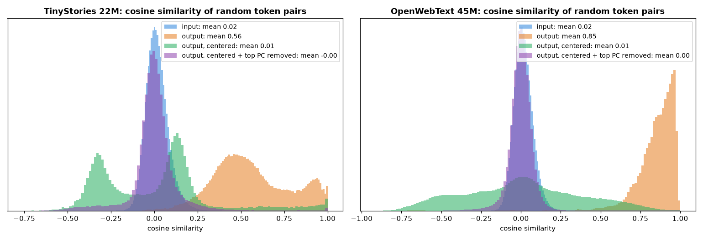

# What do my small models' token embeddings look like? (October 2026)

Token embeddings are a way to visualize how a model groups, or "sees", tokens.

> **TL;DR**
> - Even 22–45M-parameter models learn real word structure: names, colors, numbers and animals cluster, and analogies like
>   *king − man + woman ≈ queen* work (15 of 18 in the best space).
> - The **output embeddings** all point in nearly the same direction (average similarity up to 0.85), because training
>   only ever pushes rare tokens away; removing that direction and a **frequency** direction reveals the structure.
> - Tokens the model never saw keep shrinking under weight decay alone: a one-line calculation predicts their size
>   (0.031) almost exactly (0.028).

Models: [`tinystories-22m`](https://huggingface.co/tegancao/tinystories-22m) (10K-token vocabulary) and
[`owt-45m`](https://huggingface.co/tegancao/owt-45m) (32K). Each has two separate embedding matrices: the **input**
embedding ("what is this token?") and the **output** embedding, the final layer ("which token could come next?").
Token frequencies come from the public validation splits. Runs on a laptop CPU in ~2 minutes:
`uv run experiments/02-token-embeddings/embeddings.py` (writes the figures and `results.json`).

## A. Do related words cluster?

**Yes.** With t-SNE, six word groups form clean clusters in both models; even plain PCA separates some (numbers and
colors in TinyStories, names and numbers in OpenWebText). Nobody told the models these categories exist. In the full
512 dimensions the clusters are real but loose (silhouette 0.11 and 0.15, vs. −0.03 for random groups); t-SNE makes
them look crisper than they are.

## B. Why do the output embeddings all look alike?

Random pairs of **input** embeddings are unrelated (average cosine similarity 0.02), but **output** embeddings average
**0.56** (TinyStories) and **0.85** (OpenWebText): nearly everything points the same way ("anisotropy", Gao et al., 2019).
In the OpenWebText model, *dog*'s nearest neighbors are *dogs*, then *Pam, Julie, Caroline*.

**Why:** at every position, training pushes all the *wrong* answers away from the model's hidden state. Rare tokens
only ever get this "not me" push, always in a similar direction, so they drift together: their alignment with the
average output vector is 0.90–0.96, against 0.33–0.79 for common tokens.

**The fix took two tries.** Subtracting the average vector made OpenWebText's neighbors punctuation (*red* → `,` `re`
`in`). A second direction was still dominant, carrying 30–42% of the variance and correlating 0.79–0.86 with token
**frequency**. Removing it too ("all-but-the-top", Mu & Viswanath, 2018) reveals the semantics:

| Word | Raw | Centered | Centered + frequency direction removed |
|---|---|---|---|
| dog | dogs, Pam, Julie, Caroline, Rebecca | dogs, `,`, `.`, and, Someone | **dogs, cat, pet, animal, pets** |
| red | green, blue, yellow, orange, pink | `,`, re, in, and, d | **green, blue, re, black, white** |
| happy | enthusiastic, satisfied, unhappy, pleased, thrilled | `,`, in, `.`, (, 3 | **proud, pleased, willing, satisfied, thrilled** |
| tree | trees, Tree, Hannah, Jess, Harold | trees, Tree, Few, s, k | **trees, Tree, branch, ladder, mountain** |

## C. Tokens the model barely saw

Input-embedding size grows with token frequency (correlation 0.92). At the bottom are tokens that never appear in the
data, mostly tokenizer leftovers (` microw`, ` neighb`, stray bytes `�`): 1,066 of TinyStories' 10K tokens and 89 of
OpenWebText's 32K.

**Their size can be calculated.** A never-seen token gets no gradient, so only AdamW's weight decay changes it,
shrinking it a little every step. From a starting norm of ≈ 22.3, weight decay 0.1 and this learning-rate schedule
predict a final norm of **0.031**; the smallest norms in both models are **0.028–0.029**. These rows are cousins of the
"glitch tokens" in larger models: vocabulary the model has but never learned. The output embeddings show the mirror
image (the "X" in the right plot): rare tokens get the *longest* output vectors, from the steady "not me" push.

## D. Does king − man + woman ≈ queen?

| Embedding space (18 analogies) | TinyStories: top-1 | top-5 | OpenWebText: top-1 | top-5 |
|---|---|---|---|---|
| input | 12 | 15 | 11 | 13 |
| output, raw | 13 | 15 | 13 | 18 |
| output, centered + frequency direction removed | **15** | **18** | **15** | **18** |

Grammar-like analogies work best (*walk : walked :: jump : **jumped***, *dog : dogs :: cat : **cats***). *King − man +
woman* gives **queen** in the OpenWebText model (then *ruler, princess, monarch*); the TinyStories model says *princess*
first, then *queen*, fittingly for children's stories. Misses: *one : two :: three : ?* → **3** (TinyStories), and
*day : night :: morning : ?* → *afternoon* before *evening* (OpenWebText).

## References

Gao et al., 2019, [Representation Degeneration Problem](https://arxiv.org/abs/1907.12009) ·
Mu & Viswanath, 2018, [All-but-the-Top](https://arxiv.org/abs/1702.01417) ·
Mikolov et al., 2013, [Linguistic Regularities in Continuous Space Word Representations](https://aclanthology.org/N13-1090/)
