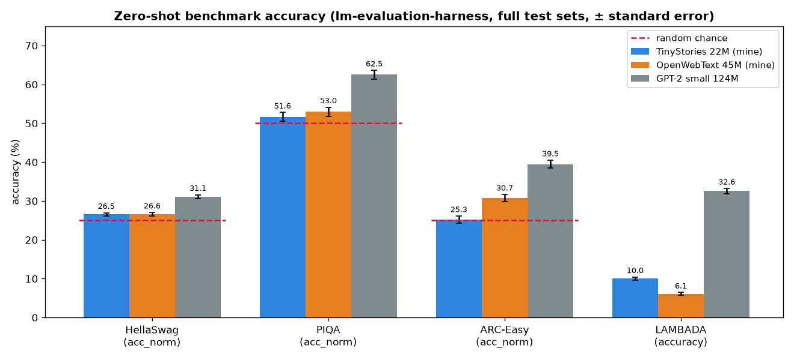

# How do my small models do on standard benchmarks? (October 2026)

Zero-shot evaluation of my two models, [`tegancao/tinystories-22m`](https://huggingface.co/tegancao/tinystories-22m)
and [`tegancao/owt-45m`](https://huggingface.co/tegancao/owt-45m), next to OpenAI's
[GPT-2 small](https://huggingface.co/openai-community/gpt2) (124M parameters) as a reference, on four standard
benchmarks with EleutherAI's [lm-evaluation-harness](https://github.com/EleutherAI/lm-evaluation-harness) (v0.4.13).
Full test sets, no examples in the prompt.



| Benchmark (chance level) | What it asks | TinyStories 22M | OpenWebText 45M | GPT-2 small 124M |
|---|---|---|---|---|
| **HellaSwag** (25%) | pick the most plausible ending of an everyday scene (4 options; 10,042 questions) | 26.5% ± 0.4 | 26.6% ± 0.4 | **31.1%** ± 0.5 |
| **PIQA** (50%) | pick the better way to do a physical task (2 options; 1,838) | 51.6% ± 1.2 | 53.0% ± 1.2 | **62.5%** ± 1.1 |
| **ARC-Easy** (25%) | grade-school science, multiple choice (2,376) | 25.3% ± 0.9 | 30.7% ± 1.0 | **39.5%** ± 1.0 |
| **LAMBADA** | predict the last word of a passage from a novel (5,153) | 10.0% ± 0.4 | 6.1% ± 0.3 | **32.6%** ± 0.7 |
| LAMBADA perplexity (lower is better) | | 70,408 | 3,695 | **40** |

(± is one standard error. For the multiple-choice tasks the metric is `acc_norm`: each option's log-likelihood
divided by its length, so long answers aren't penalized just for being long. The results in full are in
[`results.json`](results.json).)

## Model sizes and training budgets

| | TinyStories 22M | OpenWebText 45M | GPT-2 small |
|---|---|---|---|
| Parameters, total | 22.7M | 45.2M | 124.4M |
| of which embedding / output layers | 10.2M | 32.8M | 39.4M |
| of which **Transformer body** | **12.5M** | **12.5M** | **85.1M** |
| Vocabulary / context length | 10,000 / 256 | 32,000 / 256 | 50,257 / 1,024 |
| Training tokens | 0.33B | 0.33B | ≈ 9B per pass over WebText* |
| Tokens per parameter | 14 | 7 | ≈ 73* |
| Training compute (≈ 6 × parameters × tokens) | 4.5 × 10¹⁶ FLOPs | 8.9 × 10¹⁶ FLOPs | ≈ 6.8 × 10¹⁸ FLOPs* (~76× my OWT model) |

\* OpenAI didn't publish how long GPT-2 was trained. WebText is about 40 GB of text, roughly 9B tokens at ~4.4 bytes
per token; these numbers assume a single pass, so they are a lower bound.

Two things stand out. First, **my two models have the same 12.5M-parameter Transformer body**: the OpenWebText
model is "45M" only because its 32K-token vocabulary needs bigger embedding and output layers. GPT-2 small's body
is 7× larger. Second, the training budgets differ by about two orders of magnitude, and for its size my OpenWebText
model saw few tokens: 7 per parameter, against the ~20 that the "Chinchilla" scaling study (Hoffmann et al., 2022)
found compute-optimal.

## What the numbers say

**My models are close to random guessing on the reasoning benchmarks.** On HellaSwag both are only ~1.5 points above
chance (statistically above it, but barely), and the TinyStories model is at chance on ARC-Easy and PIQA. That's
expected: these benchmarks need world knowledge and commonsense, which a 22–45M-parameter model trained on 330M
tokens mostly doesn't have, and a model of children's stories has never seen science questions at all.

**The OpenWebText model is measurably better where knowledge helps:** ARC-Easy 30.7% (about 6 standard errors above
chance) and PIQA 53.0%. Web text contains at least some of the facts these questions ask about.

**GPT-2 small is clearly ahead everywhere.** Its Transformer body is 7× larger than my models' and it was trained
with roughly 76× the compute (table above), which is the point of the comparison: scale is what moves these
numbers. Even GPT-2 small is far from good, though; benchmarks like these only become easy at billions of parameters.

**The LAMBADA surprise: the TinyStories model beats the OpenWebText model on accuracy (10.0% vs 6.1%) while its
perplexity is 19× worse.** LAMBADA turns out to be largely a copying task: in 84% of passages the missing last word
already appears earlier in the passage, and 47% of the answers are capitalized, mostly character names. Stories
written for children repeat their characters' names constantly, which likely makes the TinyStories model good at
"this character again". But when it's unsure, it's very unsure: its 10K-token vocabulary splits 29% of the answer
words into three or more tokens (OpenWebText: 7%; GPT-2: 4.5%), and every extra token multiplies in more uncertainty,
so the perplexity explodes. Accuracy and perplexity can tell different stories about the same model.

## A lesson about small samples

Before the full run I tried a quick pilot on 200 examples per task. It put the TinyStories model at **32.5%** on
HellaSwag, which looked well above chance. On all 10,042 questions it is **26.5%**. With 200 questions, the standard
error is about ±3 points, so the pilot's "result" was mostly luck. Small evaluation sets are fine for checking that
a pipeline works, not for conclusions.

## Takeaways

- **A good loss on your own data is not general ability.** The TinyStories model fits its stories well (validation
  loss 1.38) and writes coherent text, yet it is at chance on every reasoning benchmark.
- **Size and data move these numbers.** GPT-2 small has a 7× larger Transformer body and ~76× the training compute,
  and it is ahead everywhere; still, even it is far from good.
- **Each model reflects its training data:** web text gives the OpenWebText model some science facts (ARC-Easy),
  children's stories give the TinyStories model practice at repeating names (LAMBADA).
- **Know what a benchmark really tests.** LAMBADA is mostly a copying test: the answer is already in the passage 84%
  of the time.
- **Metrics can disagree, and tokenizers matter.** Accuracy and perplexity rank my two models in opposite orders;
  perplexities of models with different tokenizers aren't directly comparable.
- **Small samples mislead.** 200 questions gave 32.5% on HellaSwag; all 10,042 gave 26.5%.

## Details and caveats

- **Context length.** My models were trained on 256-token windows, GPT-2 on 1,024. The harness truncates long inputs
  from the left to each model's limit. The TinyStories tokenizer turns 4 PIQA answers into more than 256 tokens, so
  that model was given a 512-token limit; only those few inputs go beyond its trained length.
- **Zero-shot** (no worked examples in the prompt), as is standard for models this small.
- Run on Modal (one NVIDIA L4 per model, in parallel, about 15 minutes; on my laptop's CPU it would have taken an
  estimated 3–6 hours, mostly for GPT-2).

## Reproduce

```
uv run --with modal modal run experiments/2026-10-benchmark-eval/modal_eval.py     # needs a Modal account
uv run experiments/2026-10-benchmark-eval/plot_results.py                          # redraws benchmarks.png
```

Optional: `WANDB_PROJECT=<project>` also logs each model's results to Weights & Biases (via a Modal secret named
`wandb`), and `LIMIT=20` runs a quick smoke test on 20 examples per task.

## References

- HellaSwag: Zellers et al., 2019, [HellaSwag: Can a Machine Really Finish Your Sentence?](https://arxiv.org/abs/1905.07830)
- PIQA: Bisk et al., 2020, [PIQA: Reasoning about Physical Commonsense in Natural Language](https://arxiv.org/abs/1911.11641)
- ARC: Clark et al., 2018, [Think you have Solved Question Answering? Try ARC](https://arxiv.org/abs/1803.05457)
- LAMBADA: Paperno et al., 2016, [The LAMBADA dataset](https://arxiv.org/abs/1606.06031)
- Hoffmann et al., 2022, [Training Compute-Optimal Large Language Models](https://arxiv.org/abs/2203.15556) ("Chinchilla")
