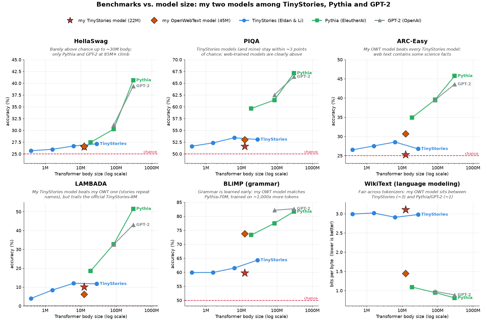
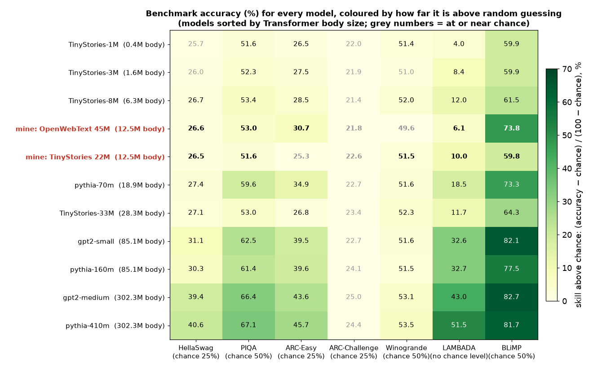
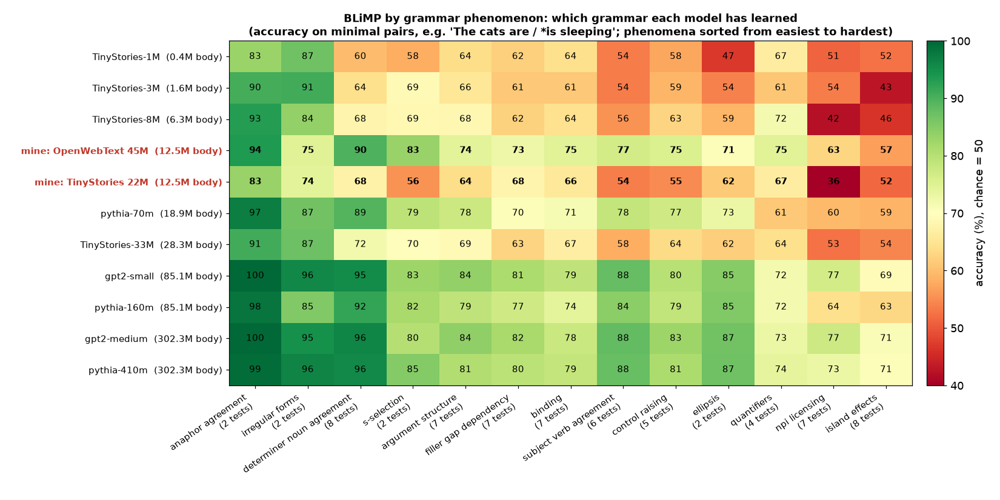

# How do my small models do on standard benchmarks? (October 2026)

Benchmarks put small models in perspective next to big ones. They show that grammar is easy to learn, but logic,
structured facts and the like are not.

My two models ([`tinystories-22m`](https://huggingface.co/tegancao/tinystories-22m),
[`owt-45m`](https://huggingface.co/tegancao/owt-45m)) next to nine public models, on eight benchmarks: zero-shot, full
test sets, [lm-evaluation-harness](https://github.com/EleutherAI/lm-evaluation-harness) v0.4.13.

> **TL;DR**
> - Small models learn **grammar before knowledge**: my OpenWebText model matches Pythia-70M on BLiMP (73.8% vs. 73.3%)
>   while staying near chance on reasoning benchmarks.
> - **The training data sets the ceiling**: TinyStories models are equally near chance on general benchmarks across a
>   70× range of sizes.
> - Compare models by **Transformer body size** and **bits per byte**, not total parameters or perplexity.
> - **Look inside benchmarks**: LAMBADA is mostly copying; a below-chance score can be a surface preference.



The x-axis is the **Transformer body** (all parameters except embedding and output layers): both my models have the
same 12.5M body; the OpenWebText one is "45M" only because of its bigger vocabulary. Accuracy panels start at the
chance line. ARC-Challenge and Winogrande are left out of this plot (everyone is near chance); see the table.

## Models

| Family | Models | Training data | Tokens |
|---|---|---|---|
| **mine** | tinystories-22m, owt-45m | TinyStories / OpenWebText sample | 0.33B (7–14 per parameter; ~20 is compute-optimal) |
| TinyStories (Eldan & Li, 2023) | 1M, 3M, 8M, 33M | TinyStories | not stated |
| Pythia (Biderman et al., 2023) | 70M, 160M, 410M | the Pile, incl. Wikipedia | 300B |
| GPT-2 (Radford et al., 2019) | small, medium | WebText, Wikipedia removed | ≈ 9B per pass (not published) |

## Results

Accuracy in % (WikiText: bits per byte, lower is better). Chance: 25% for HellaSwag and ARC; 50% for PIQA, Winogrande
and BLiMP. Standard errors are ±0.15–1.4 points. Full numbers in [`results.json`](results.json).

| Model | Body | Total | HellaSwag | PIQA | ARC-Easy | ARC-Challenge | Winogrande | LAMBADA | BLiMP | WikiText bits/byte |
|---|---|---|---|---|---|---|---|---|---|---|
| TinyStories-1M | 0.4M | 3.7M | 25.7 | 51.6 | 26.5 | 22.0 | 51.4 | 4.0 | 59.9 | 2.99 |
| TinyStories-3M | 1.6M | 8.3M | 26.0 | 52.3 | 27.5 | 21.9 | 51.0 | 8.4 | 59.9 | 3.02 |
| TinyStories-8M | 6.3M | 19.7M | 26.7 | 53.4 | 28.5 | 21.4 | 52.0 | 12.0 | 61.5 | 2.91 |
| **mine: OpenWebText 45M** | 12.5M | 45.2M | 26.6 | 53.0 | 30.7 | 21.8 | 49.6 | 6.1 | 73.8 | 1.45 |
| **mine: TinyStories 22M** | 12.5M | 22.7M | 26.5 | 51.6 | 25.3 | 22.6 | 51.5 | 10.0 | 59.8 | 3.11 |
| pythia-70m | 18.9M | 70.4M | 27.4 | 59.6 | 34.9 | 22.7 | 51.6 | 18.5 | 73.3 | 1.09 |
| TinyStories-33M | 28.3M | 68.5M | 27.1 | 53.0 | 26.8 | 23.4 | 52.3 | 11.7 | 64.3 | 2.98 |
| gpt2-small | 85.1M | 124.4M | 31.1 | 62.5 | 39.5 | 22.7 | 51.6 | 32.6 | 82.1 | 0.98 |
| pythia-160m | 85.1M | 162.3M | 30.3 | 61.4 | 39.6 | 24.1 | 51.5 | 32.7 | 77.5 | 0.95 |
| gpt2-medium | 302.3M | 354.8M | 39.4 | 66.4 | 43.6 | 25.0 | 53.1 | 43.0 | 82.7 | 0.89 |
| pythia-410m | 302.3M | 405.3M | 40.6 | 67.1 | 45.7 | 24.4 | 53.5 | 51.5 | 81.7 | 0.81 |



*HellaSwag*: plausible endings of everyday scenes; *PIQA*: physical common sense; *ARC*: school science; *Winogrande*:
pronoun resolution; *LAMBADA*: last word of a novel passage; *BLiMP*: grammatical vs. ungrammatical sentence pairs;
*WikiText*: predicting Wikipedia text.

## What the numbers say

**1. Two benchmarks show almost nothing at this scale.** Every model stays close to chance on ARC-Challenge and
Winogrande; some are slightly *below* chance on ARC-Challenge, whose questions were picked to fool simple methods.

**2. The training data sets the ceiling.** The four TinyStories models span 70× in size but are all near chance on
HellaSwag, PIQA, ARC and WikiText. A good loss on your own data (my TinyStories model: 1.38) is not general ability.

**3. Grammar comes first.** Every model is well above chance on BLiMP, and my OpenWebText model equals Pythia-70M,
which saw ~1,000× more tokens. Broken down by phenomenon:



- Anaphor agreement (*he ... himself*) and irregular verbs are easy even for the smallest model (83–87%); island
  effects, NPI licensing (*any*, *ever*) and quantifiers stay at or below 77% for every model.
- My OpenWebText model beats my TinyStories one on agreement (subject–verb 77% vs. 54%, determiner–noun 90% vs. 68%).
- My TinyStories model picks *Bruce had ever played.* over *Had Bruce ever played?* 93% of the time, like every
  TinyStories model (4–7% correct). Likely a preference for familiar statement shapes, not a rule about *ever*;
  BLiMP can't tell the difference. TinyStories models are below chance on 13–16 of 67 sub-tests, web-trained ones on 3–5.

**4. Bits per byte is the fair comparison.** On Wikipedia, my OpenWebText model needs 1.45 bits per byte: between the
TinyStories models (~3) and Pythia/GPT-2 (0.8–1.1). Pythia beats GPT-2 at equal size, plausibly because its data
includes Wikipedia.

**5. Knowledge needs size and data together.** HellaSwag, PIQA, ARC-Easy and LAMBADA climb clearly only for Pythia and
GPT-2; Pythia-410M leads GPT-2 medium on LAMBADA (51.5% vs. 43.0%).

**6. Accuracy and perplexity can disagree.** On LAMBADA my TinyStories model beats my OpenWebText one on accuracy (10.0%
vs. 6.1%) but has 19× worse perplexity. In 84% of passages the answer already appears earlier (often a name, which
stories repeat), but the TinyStories tokenizer splits 29% of answers into 3+ tokens, and each extra token adds
uncertainty.

## My predictions, checked

Before seeing the results I wrote down what I expected:

| Prediction | Result |
|---|---|
| ARC-Challenge and Winogrande near chance for all models | ✅ |
| BLiMP clearly above chance for every model | ✅ (and my OpenWebText model matches Pythia-70M) |
| WikiText: Pythia and GPT-2 best (Pythia ahead), my OpenWebText model in the middle, TinyStories models worst | ✅ |
| Pythia ≈ GPT-2 at equal body size | ✅ mostly; Pythia ahead on LAMBADA, GPT-2 small ahead on BLiMP |
| My TinyStories model between the official TinyStories-8M and -33M | ❌ |

The miss is the most interesting result for me: with a 2× larger body than TinyStories-8M, my TinyStories model is
slightly *below* it on BLiMP (59.8% vs. 61.5%) and LAMBADA (10.0% vs. 12.0%). The original models were most likely
trained for much longer (their training length isn't on the model cards; mine saw about 61% of the dataset once), and
they use a 50K-token vocabulary instead of my 10K. Next, I'd train it longer, so it sees more tokens, and try
shuffling the balance between the number of layers and `d_model` to see if it does better.

A lesson from the pilot: on 200 HellaSwag questions my TinyStories model scored 32.5%; on all 10,042, 26.5%. With 200
questions the standard error is about ±3 points, so small samples are only good for checking the pipeline.

## Caveats

- **Context length:** 256 tokens for my models (512 for the TinyStories one, whose tokenizer turns 4 PIQA answers into
  more than 256 tokens), 1,024 for GPT-2, 2,048 for the others.
- **One training run per model:** gaps of a point or two between similar models may be run-to-run variation; the
  standard errors only cover benchmark size.
- **Data overlap:** Pythia's training data includes Wikipedia, which helps it on WikiText.

## Reproduce

```
uv run --with modal modal run experiments/2026-10-benchmark-eval/modal_eval.py     # Modal: up to 8 L4 GPUs, ~30 min, a few dollars
uv run experiments/2026-10-benchmark-eval/plot_results.py                          # redraws the three figures
```

Optional: `WANDB_PROJECT=<project>` logs results to Weights & Biases (needs a Modal secret named `wandb`);
`LIMIT=20` runs a quick smoke test.

## References

[HellaSwag](https://arxiv.org/abs/1905.07830) · [PIQA](https://arxiv.org/abs/1911.11641) ·
[ARC](https://arxiv.org/abs/1803.05457) · [WinoGrande](https://arxiv.org/abs/1907.10641) ·
[LAMBADA](https://arxiv.org/abs/1606.06031) · [BLiMP](https://arxiv.org/abs/1912.00582) ·
[WikiText](https://arxiv.org/abs/1609.07843) · [TinyStories](https://arxiv.org/abs/2305.07759) ·
[Pythia](https://arxiv.org/abs/2304.01373) · GPT-2 (Radford et al., 2019) ·
[Chinchilla](https://arxiv.org/abs/2203.15556) (compute-optimal training)
