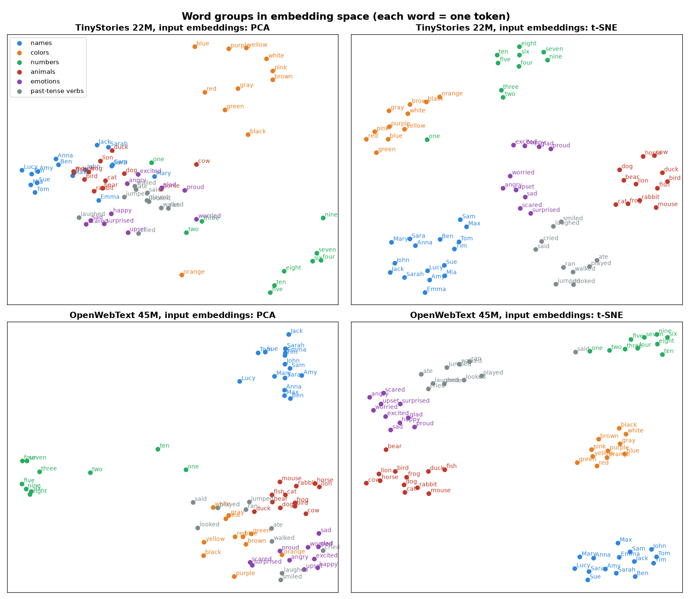
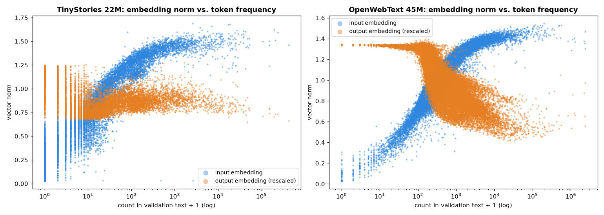

# What do my small models' token embeddings look like? (October 2026)

Four experiments on the token embeddings of my two models trained from scratch:
[`tegancao/tinystories-22m`](https://huggingface.co/tegancao/tinystories-22m) (10K-token vocabulary) and
[`tegancao/owt-45m`](https://huggingface.co/tegancao/owt-45m) (32K). Each model has two embedding matrices, because
the input and output embeddings are not shared ("untied"):

- the **input embedding** turns a token into a vector at the start ("what is this token?");
- the **output embedding** (the final layer) scores every token as the possible next one ("where can this token go?").

Token frequencies are counted on each dataset's public validation split (5.5M tokens of TinyStories, 66M of
OpenWebText). Everything is reproducible on a laptop CPU in about two minutes:

```
uv run experiments/2026-10-token-embeddings/embeddings.py
```

It writes the figures and `results.json` (all numbers below, plus full neighbor lists and analogy answers).

## A. Do related words cluster?

Six groups of words (names, colors, numbers, animals, emotions, past-tense verbs; only words that are a single token
in that model's vocabulary), projected from 512 dimensions to 2:



**Yes.** With t-SNE, all six groups form clean, separate clusters in both models; even PCA, a plain linear
projection, already separates some groups (numbers and colors in TinyStories, names and numbers in OpenWebText). The models were never told these categories exist: words that are used in
similar contexts simply end up with similar vectors.

A caution about how strong this is: t-SNE is designed to make clusters look crisp. Measured in the original 512
dimensions, the groups are real but loose: the silhouette score (−1 to 1, higher = better separated) is **0.11**
(TinyStories) and **0.15** (OpenWebText), against **−0.03** when the same words get random group labels.

## B. Why do the output embeddings all look alike?

For random pairs of tokens, the cosine similarity of their **input** embeddings averages 0.02, as you'd expect for
unrelated vectors. For their **output** embeddings it averages **0.56** (TinyStories) and **0.85** (OpenWebText): almost
every token points the same way. This is called **anisotropy**, or the representation degeneration problem
(Gao et al., 2019).


It makes the raw output space unreliable for finding similar words. In the OpenWebText model, the nearest
neighbors of *dog* are *dogs*, then *Pam, Julie, Caroline, Rebecca*; for *tree*, *trees, Tree*, then *Hannah, Jess*.

**Why it happens.** For the output embeddings, training pushes every token that was *not* the right answer a little
away from the model's current hidden state, at every position. A token that is rarely the right answer only ever
gets this "not me" push, always in roughly the same direction, so all rare tokens drift together. The data agrees:

| | TinyStories | OpenWebText |
|---|---|---|
| alignment of **rare** tokens (< 5 occurrences) with the average output embedding | 0.90 | 0.96 |
| alignment of **common** tokens (≥ 1,000 occurrences) | 0.33 | 0.79 |

**Removing the shared direction.** Subtracting the average vector ("centering") is the obvious fix, and it brings the
mean similarity to ~0, but for OpenWebText the neighbors become punctuation (*red* → `,` `re` `in` `and`). One more
direction is still dominant: after centering, the top principal component carries **30%** (TinyStories) and **42%**
(OpenWebText) of all the variance, and it correlates **0.79** and **0.86** with the log of token frequency. It is a
*frequency* direction. Removing it as well ("all-but-the-top", Mu & Viswanath, 2018) reveals clean semantic structure
(OpenWebText model, output embeddings):

| Word | Raw | Centered | Centered + frequency direction removed |
|---|---|---|---|
| dog | dogs, Pam, Julie, Caroline, Rebecca | dogs, `,`, `.`, and, Someone | **dogs, cat, pet, animal, pets** |
| red | green, blue, yellow, orange, pink | `,`, re, in, and, d | **green, blue, re, black, white** |
| happy | enthusiastic, satisfied, unhappy, pleased, thrilled | `,`, in, `.`, (, 3 | **proud, pleased, willing, satisfied, thrilled** |
| tree | trees, Tree, Hannah, Jess, Harold | trees, Tree, Few, s, k | **trees, Tree, branch, ladder, mountain** |

Removing more than one direction changes little.

## C. Tokens the model barely saw



The length (norm) of a token's **input** embedding grows steadily with how often the token occurs: the correlation with
log frequency is **0.92** in both models. At the bottom sit tokens that (almost) never appear in the training data:
1,066 of TinyStories' 10K tokens and 89 of OpenWebText's 32K never occur in the validation text, and their median norms
are 0.17 and 0.03, against ~1.0 for tokens that do occur. The very smallest are leftovers of the tokenizer: word
fragments like ` microw`, ` neighb`, ` newslet`, ` unsuccess`, stray bytes (`�`) and control characters.

**These numbers can be predicted exactly.** A token that never appears never gets a gradient, so its input embedding
only changes through AdamW's weight decay, which shrinks it a little at every step. Starting from a random vector of
norm ≈ 22.3 (each value drawn from a standard normal truncated at ±3), weight decay 0.1 and this run's learning-rate schedule should
shrink it by a factor of 0.00138, to **≈ 0.031**. The smallest norms in the two models are **0.028–0.029**, most
likely never-trained tokens that happened to start slightly shorter than average. These near-zero rows are cousins of the
"glitch tokens" found in larger models: vocabulary the model has, but never really learned.

The **output** embeddings show the mirror image, clearest in OpenWebText (the "X" in the right plot): rare tokens have
the *longest* output vectors, built up by the steady "not me" push from section B.

## D. Does king − man + woman ≈ queen?

For 18 analogies (gender, plurals, past tense, comparatives, opposites, number sequence), the model "solves" *a : b ::
c : ?* if the token closest to *b − a + c* (excluding *a*, *b*, *c*) is the expected answer:

| Embedding space | TinyStories: top-1 | top-5 | OpenWebText: top-1 | top-5 |
|---|---|---|---|---|
| input | 12/18 | 15/18 | 11/18 | 13/18 |
| output, raw | 13/18 | 15/18 | 13/18 | 18/18 |
| output, centered + frequency direction removed | **15/18** | **18/18** | **15/18** | **18/18** |

Grammar-like relations work best (*walk : walked :: jump : **jumped***, *dog : dogs :: cat : **cats***, *fast : faster ::
slow : **slower***). The famous *man : woman :: king : ?* gives **queen** in the OpenWebText model's corrected space
(followed by *ruler, princess, monarch, crown*), while the TinyStories model answers *princess* first and *queen*
second, fittingly for a model of fairy-tale-like children's stories. Typical misses: *one : two :: three : ?* gives
**3** in the TinyStories model (it pattern-matches "three" to the digit) and *day : night :: morning : ?* gives
*afternoon* before *evening* in the OpenWebText model.

## Takeaways

- Even 22–45M-parameter models trained for a few hours learn meaningful word structure: categories, gender, tense,
  plurals, antonyms.
- The output embeddings hide that structure behind a shared direction and a frequency direction, which come straight
  from how softmax training treats rare tokens. Removing those two directions makes the output space the best of the
  three for analogies.
- Optimizer details leave fingerprints you can calculate: weight decay alone predicts the norms of never-seen tokens to
  within a few percent.

## References

- Gao et al., 2019. [Representation Degeneration Problem in Training Natural Language Generation Models](https://arxiv.org/abs/1907.12009).
- Mu & Viswanath, 2018. [All-but-the-Top: Simple and Effective Postprocessing for Word Representations](https://arxiv.org/abs/1702.01417).
- Mikolov et al., 2013. [Linguistic Regularities in Continuous Space Word Representations](https://aclanthology.org/N13-1090/) (word analogies).
