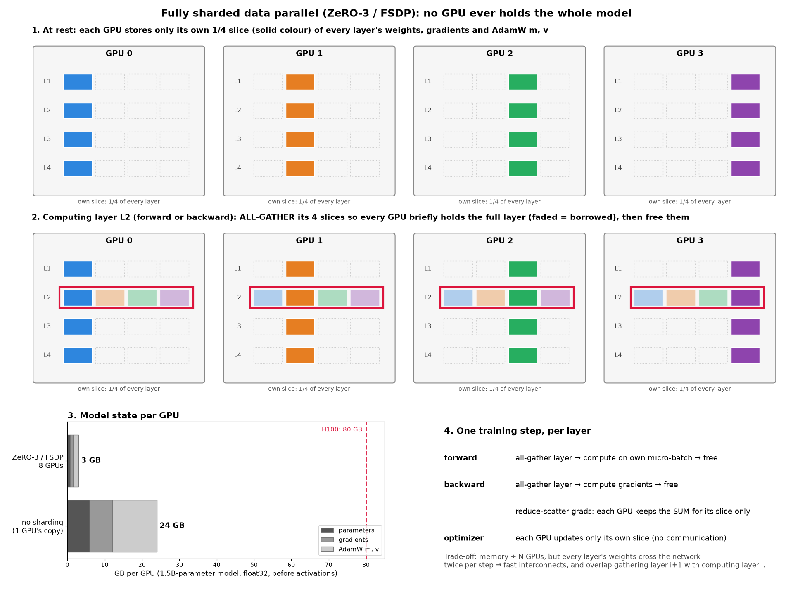

# Scaling: memory, compute, and sharding across GPUs

Notes from training my first small language models from scratch, and from working out what it would take to train
something GPT-2-sized. Numbers for GPT-2 XL use its published size (~1.5B parameters).

## Model size in practice

My two models: a 22.7M-parameter model trained on TinyStories (10K-token vocabulary) and a 45.2M-parameter model trained
on OpenWebText (32K vocabulary). Same architecture (4 layers, d_model 512): the bigger vocabulary alone doubles the
parameter count, because the input embedding and output layer are each `vocab × d_model`. For comparison, GPT-2 comes
in 124M, 355M, 774M and 1.5B.

## MFU: how much of the GPU you actually use

**Model FLOPs utilization** = achieved model FLOP/s ÷ the GPU's peak FLOP/s at that precision. For training, achieved
FLOP/s ≈ 6 × parameters × tokens per second (forward ≈ 2 FLOPs per parameter per token, backward ≈ twice that).
H100 peak: ≈ 990 TFLOP/s (bf16, dense) or ≈ 495 (TF32).

- Good large runs reach **30–50%**.
- My 45M model on an L4 reached only **~4%**: its matrix multiplies are small, so per-step overhead dominates.
- Bigger models mean bigger matmuls and higher arithmetic intensity, so MFU rises, until memory limits force small
  per-GPU batches, recomputation and communication.

## Training memory

In float32 with AdamW, every parameter needs 16 bytes of **fixed** state: the parameter (4), its gradient (4) and
AdamW's two moment estimates (8). On top of that come the **activations** saved for the backward pass, which grow with
batch size and include a sequence-length-squared term for attention scores. For a 1.5B model the fixed part alone is
24 GB, before a single activation; activations then dominate quickly. I hit this wall at small scale: batch 256 of my
22.7M model ran out of memory on a 22 GiB L4.

| Technique | Removes | Cost |
|---|---|---|
| bf16 mixed precision | half of activation memory (and ~2× faster matmuls) | fp32 master weights kept |
| FlashAttention | the stored T × T attention score matrices | none: it is also faster (less memory traffic) |
| activation checkpointing | most stored activations | ~30% recomputation (counts against MFU) |
| gradient accumulation | activations of all but one micro-batch | more, smaller steps |
| ZeRO-1/2/3, FSDP | optimizer state / + gradients / + parameters, ÷ N GPUs | communication |
| tensor / pipeline parallelism | splits each layer's matrices / splits the layers | more communication, pipeline bubbles |

## FSDP / ZeRO-3: no GPU holds the whole model

Each GPU permanently keeps only its 1/N slice of every parameter, gradient and optimizer state. Just before a layer
runs, its full weights are **all-gathered** from all GPUs, used, and freed. Gradients are **reduce-scattered**: each
GPU ends up with the sum of everyone's gradients for its own slice only, and updates just that slice. A 1.5B model's
24 GB of fixed state becomes 3 GB per GPU on 8 GPUs.

(Figure drawn by [`make_fsdp_figure.py`](make_fsdp_figure.py).)

### How the GPUs stay in sync

All-gather and reduce-scatter are **collective operations** (run by a library like NCCL): every GPU calls them
together, and each waits until all have arrived. So the GPUs move through the layers in lockstep, and the slowest GPU
sets the pace. A **ring** algorithm makes them efficient: arranged in a ring, each GPU passes one slice to its neighbor
while receiving one from the other side; after N−1 steps everyone has everything, and each GPU has moved only
(N−1)/N of the data, however many GPUs there are.

To hide the cost, GPUs communicate and compute at the same time: while computing layer i, FSDP already gathers layer
i+1 (prefetching).

### What syncing costs (rough estimate, 1.5B model, 8 GPUs, bf16 weights)

Each pass over the parameters moves about (7/8) × 1.5B × 2 bytes ≈ 2.6 GB per GPU, and FSDP makes about three
passes per step (gather in forward, gather in backward, reduce-scatter of gradients): ~8 GB per GPU per step.

| Link | Bandwidth (rough) | Communication per step | vs. ~330 ms of compute (16K tokens per GPU) |
|---|---|---|---|
| NVLink, inside one server | ~400 GB/s | ~20 ms | ~6%: easily hidden by overlap |
| InfiniBand, between servers | ~50 GB/s | ~160 ms | ~50%: only partly hidden |

Communication scales with model size, computation with tokens per GPU. That's why large runs use big per-GPU batches,
**hybrid sharding** (shard inside a server over fast links, plain data parallelism between servers), and low-precision
communication.

### Does it make training faster?

Sharding itself is about **memory**: it adds communication, so each GPU is slightly slower per token. The speedup comes
from **data parallelism**: N GPUs process N micro-batches per step, so the same tokens take about 1/N of the time.
FSDP does both at once. The price is a little more total GPU time, for a lot less waiting. Speedup isn't unlimited:
communication grows relative to compute, and beyond a "critical batch size" a larger global batch no longer cuts the
number of steps proportionally.

## Compute estimate: what would GPT-2 XL cost?

Training costs ≈ 6 × parameters FLOPs per token. GPT-2 XL (1.5B) on two passes over full OpenWebText (~18B tokens):
6 × 1.5 × 10⁹ × 18 × 10⁹ ≈ **1.6 × 10²⁰ FLOPs**, i.e. ~180 H100-hours at 50% MFU in TF32, or ~100 in bf16 at 45%.
It wouldn't fit on one small GPU without sharding. For reference, Karpathy's llm.c reproduced a GPT-2 1.6B-scale model
on ~32B tokens in ~24 hours on 8 H100s (~190 H100-hours).

My own OpenWebText model, by comparison, took 0.41 s per step on one L4: 327.68M tokens in 4.5 hours. A full pass over
OpenWebText (~9B tokens) at that speed would take about five days.
